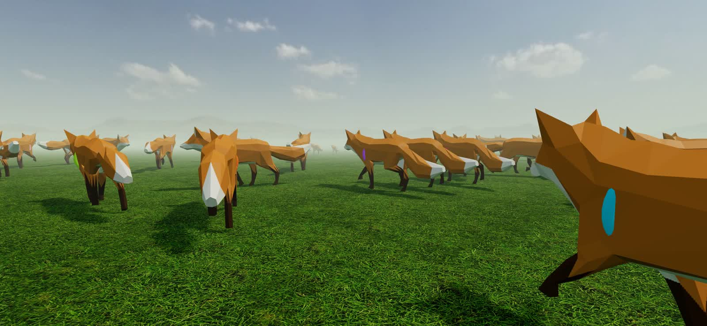
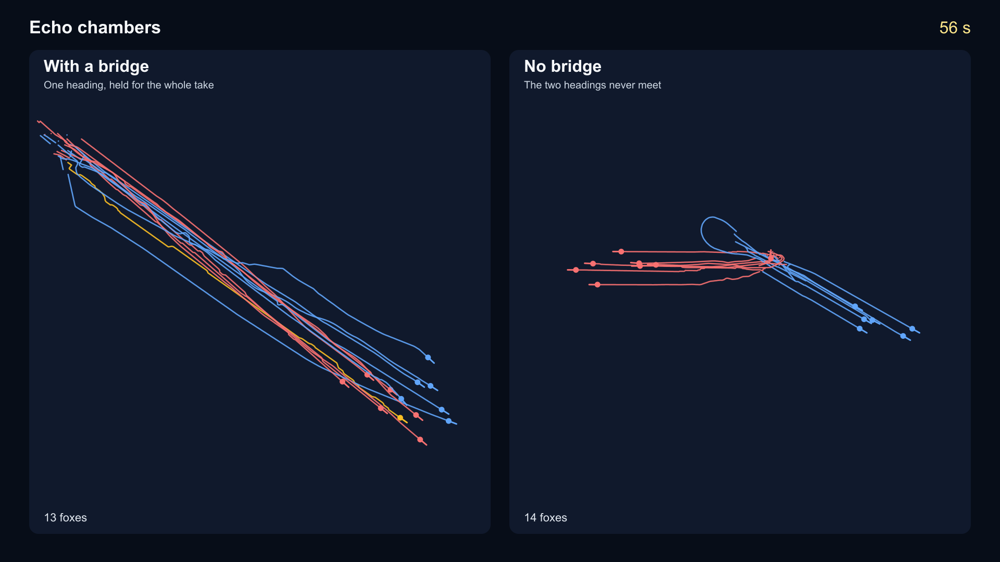
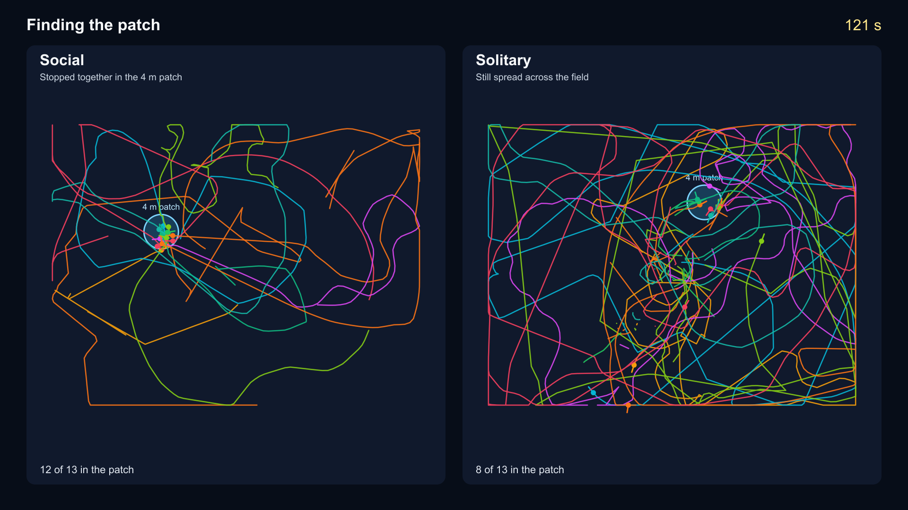

# Classroom collective behaviour

Fifteen people, one shared field. Each student is an animal. They only see whoever the experiment allows, and the pattern you measure afterwards is the collective behaviour.

The stills below are the recordings. Under each one is the video, so the lines stay sharp.



<video src="https://raw.githubusercontent.com/pvnkmrksk/classroom-agents/main/examples/videos/fpv-herd.mp4" poster="examples/posters/fpv-herd.jpg" autoplay muted loop playsinline width="100%"></video>

[Play the first-person video](examples/videos/fpv-herd.mp4)



<video src="https://raw.githubusercontent.com/pvnkmrksk/classroom-agents/main/examples/videos/echo-side-by-side.mp4" poster="examples/posters/echo-side-by-side.png" autoplay muted loop playsinline width="100%"></video>

[Play the echo chambers video](examples/videos/echo-side-by-side.mp4)

**Echo chambers.** Blue sees only blue, red only red. The bridge clip is the other recording: blue, red, and the gold bridge hold one heading for the whole take. Without a bridge they finish on two headings.



<video src="https://raw.githubusercontent.com/pvnkmrksk/classroom-agents/main/examples/videos/taxis-side-by-side.mp4" poster="examples/posters/taxis-side-by-side.png" autoplay muted loop playsinline width="100%"></video>

[Play the patch-finding video](examples/videos/taxis-side-by-side.mp4)

**Finding a patch.** The patch is 4 m across. Solitary now starts at the beginning of that recording, when the circle is empty. The median fox is inside at **39 seconds**, and at **131 seconds** the group is still spread. Social is inside at **26 seconds** and stopped together by **36 seconds**.

The clips are real class runs. The trajectories are in [`examples/replays/`](examples/replays/). They load into the dashboard on startup, unchecked, so they do not enter a new lecture’s average. Open the trial list and press **Replay**. On the [browser page](https://pvnkmrksk.github.io/classroom-agents/) you can play and scrub the same files without installing anything. Nothing you do there is uploaded.

## Run the live class

Needs Node 20 or newer. This is the part a static site cannot do: one server, fifteen students.

```bash
git clone https://github.com/pvnkmrksk/classroom-agents.git
cd classroom-agents
npm install
npm start
```

- Students: [http://localhost:3000](http://localhost:3000) — name, then join code `matrex`
- Lecturer: [http://localhost:3000/admin](http://localhost:3000/admin) — key `matrexvr`

From another network, in a second terminal:

```bash
npm run public
```

Leave it open. It prints an `https://….trycloudflare.com` link. That link changes every time you start it. Students use the link plus `matrex`. You use the same link with `/admin` and `matrexvr`.

If port 3000 is already taken:

```bash
lsof -ti :3000 | xargs kill -9
pkill -f "cloudflared tunnel --url http://127.0.0.1:3000"
npm run public
```

Students: click to lock the mouse, WASD or arrows to move, mouse to look. Hard-refresh (`Cmd+Shift+R`) after you update the server.

The hour-by-hour lecture plan is [`LECTURE.md`](LECTURE.md). Handover notes for changing the software are [`AGENTS.md`](AGENTS.md).

## What to press

The buttons along the top of the dashboard are the canonical models. One click resets that experiment.

| Button | What the class is doing | What you measure | Source |
|---|---|---|---|
| 1A Entrainment | Students see only a marching swarm. You set its order R and heading θ | Order Φ and entrainment to θ. High R locks the march; R = 0 is a meandering walk | Vicsek et al., Phys. Rev. Lett. (1995); Buhl et al., Science (2006) |
| 1B Handoff | The swarm vanishes. Students see only each other | Does Φ hold, decay, or pick a new heading | Buhl et al., Science (2006) |
| 2 Bifurcation | Two bot streams at ±Δθ/2 | One peak in the heading histogram means they averaged. Two peaks means they split | Couzin et al., Nature (2005) |
| 3 Informed | Three students privately see a beacon. The rest are not told the direction | Does the hidden minority steer all fifteen | Couzin et al., Nature (2005) |
| 4A Echo chambers | Blue sees only blue, red sees only red. One bridge can see both, or you remove the bridge | One shared heading, or two headings that never meet. The clip above is this | Network split in the same spirit as the two-choice model |
| 4B Topological | Each student sees their k nearest neighbours, however far | Cohesion when the group is stretched, against a fixed radius | Ballerini et al., PNAS (2008) |
| 5 Looming | One student sees a dive on a straight line and can step off it | Whether the neighbours bolt without seeing the threat | Looming / collision-detector tradition |
| 6A / 6B Taxis | A patch slows everyone down. 6A can see each other. 6B can see no one | Who accumulates in the patch, and when. The clip above is this | Berdahl et al., Science (2013) |
| 7 Stop and go | An automatic pause just before a bump | Pause waves through the group | Ariel et al. (2014); Bazazi et al. (2008) |
| 8 Avoid bumps | Contact costs integrity. Dead time is how long they stay down at zero | Whether alignment appears because crossing hurts. The first clip is this | Bazazi et al. (2008); Romanczuk et al. (2009) |

Φ is the Vicsek order parameter: 0 when headings are random, 1 when they agree. The polar rose is the direction they actually picked. The heading histogram is the crux plot for the choice experiments: one peak or two.

**God view.** Global draws the unwrapped path, so a straight march is a straight line. Periodic cell is the single hex: trails stop at the seam, and clones are faint outlines. Scroll zooms, drag pans.

**Trials.** Record, stop, uncheck a bad take, and the mean line is only the ones you kept. Raw JSON and Trials CSV download the shelf. A restart does not delete saved trials or the session log in `logs/`. It does drop whoever is connected and any take you had not stopped.

## Replay and regenerate

| Run | Replay | Video |
|---|---|---|
| First person |  | [`examples/videos/fpv-herd.mp4`](examples/videos/fpv-herd.mp4) |
| Echo chambers, side by side |  | [`examples/videos/echo-side-by-side.mp4`](examples/videos/echo-side-by-side.mp4) |
| Patch finding, side by side |  | [`examples/videos/taxis-side-by-side.mp4`](examples/videos/taxis-side-by-side.mp4) |
| Echo chambers, with a bridge | [`examples/replays/echo-with-bridge.json`](examples/replays/echo-with-bridge.json) | |
| Echo chambers, no bridge | [`examples/replays/echo-no-bridge.json`](examples/replays/echo-no-bridge.json) | |
| Patch finding, social | [`examples/replays/taxis-social.json`](examples/replays/taxis-social.json) | |
| Patch finding, solitary | [`examples/replays/taxis-solo.json`](examples/replays/taxis-solo.json) | |

Posters are in [`examples/posters/`](examples/posters/). To draw the videos again from a local trial shelf (`trials/lecture-trials.json`) you need `ffmpeg`:

```bash
npm run examples
```

The patch in that clip is 4 m across. The solitary side starts at the beginning of the recording, when nobody is in the circle. The bridge clip is the other echo recording, the one where the two colours hold one heading the whole way.

## References

- Vicsek, T., Czirók, A., Ben-Jacob, E., Cohen, I. and Shochet, O. Novel type of phase transition in a system of self-driven particles. *Physical Review Letters* (1995).
- Buhl, J., Sumpter, D. J. T., Couzin, I. D., Hale, J. J., Despland, E., Miller, E. R. and Simpson, S. J. From disorder to order in marching locusts. *Science* (2006).
- Couzin, I. D., Krause, J., Franks, N. R. and Levin, S. A. Effective leadership and decision-making in animal groups on the move. *Nature* (2005).
- Ballerini, M., Cabibbo, N., Candelier, R., Cavagna, A., Cisbani, E., Giardina, I., Lecomte, V., Orlandi, A., Parisi, G., Procaccini, A., Viale, M. and Zdravkovic, V. Interaction ruling animal collective behavior depends on topological rather than metric distance: Evidence from a field study. *PNAS* (2008).
- Berdahl, A., Torney, C. J., Ioannou, C. C., Faria, J. J. and Couzin, I. D. Emergent sensing of complex environments by mobile animal groups. *Science* (2013).
- Bazazi, S., Buhl, J., Hale, J. J., Anstey, M. L., Sword, G. A., Simpson, S. J. and Couzin, I. D. Collective motion and cannibalism in locust migratory bands. *Current Biology* (2008).
- Romanczuk, P., Couzin, I. D. and Schimansky-Geier, L. Collective motion due to individual escape and pursuit response. *Physical Review Letters* (2009).
